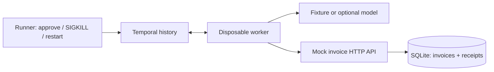

# Architecture and guarantees

The reasoning adapter proposes an invoice; Python validates it. A persisted approval
signal authorizes that proposal. Temporal schedules an Activity which calls an independent
HTTP invoice receiver. The receiver atomically stores the invoice and a tenant-scoped
idempotency receipt. Worker processes can disappear without deleting either database.

A recorded Activity result is reused during replay. An Activity whose completion was
not recorded can run again. Idempotency protects the external effect only because
this receiver implements an atomic, durable receipt contract. It is not a universal
exactly-once promise. Reuse the business key across transport retries and job resubmission;
never invent a new key to escape an unknown result.

This is NOT an authenticated multi-tenant API. Tenant IDs demonstrate key scoping,
not authorization. Test endpoints are enabled only with LAB_TEST_MODE=1, ports bind
localhost, and no real invoices or payments are involved. In production, authenticate
callers, derive tenant identity from that principal, scope lookup authorization, and
remove fault controls.

Local test settings intentionally favor fast diagnosis: 0.5 s HTTP timeout, 2 s
invoice Activity timeout, three attempts, 0.1 s initial backoff doubling to 1 s.
Model calls use 15 s Activities. These are not production timeout recommendations.
Concurrent tests and slow laptops may need longer timeouts; changing them changes
what timing results can be compared. The runner waits on explicit barriers for kills.

The approval signal only accepts a Boolean for this single immutable proposal. A real
system must authenticate approvers and bind approvals to proposal versions, scopes,
and expiry; this lab does not solve changing authorization during a retry.

Workflow deployments must preserve replay compatibility (patching or worker versioning).
Do not edit workflow control flow underneath live executions without migration tests.
History can contain model inputs and tool outputs; apply retention, access controls,
and encryption appropriate to those data. A completed model Activity is not called
again on replay, but a lost model response can cause another billable model call.

Cancellation before dispatch prevents a new invoice in our test. It does not undo a
remote commit, recall an in-flight request, or provide compensation. Reconcile uncertain
outcomes with GET by operation ID and escalate rather than guessing.
